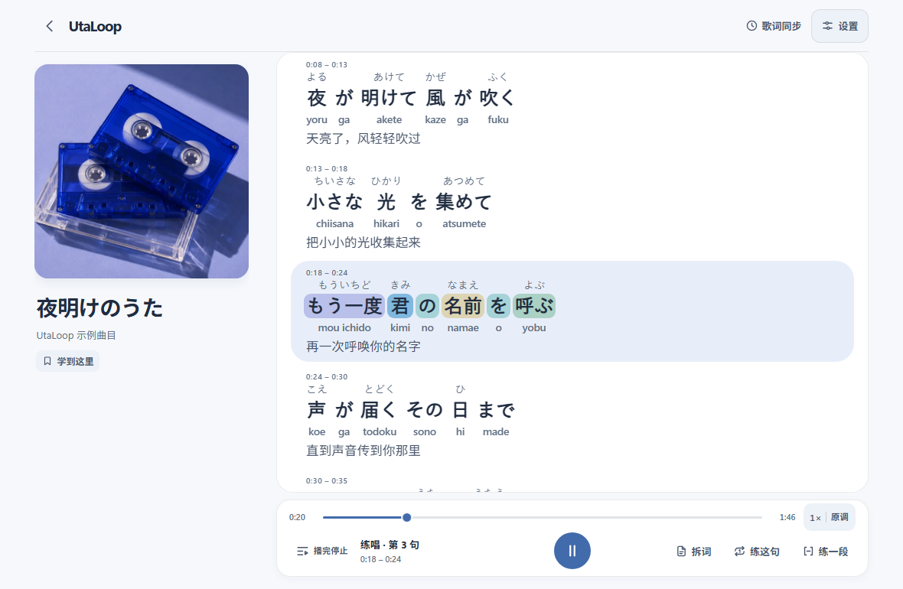

# UtaLoop

UtaLoop 是为日语跟唱设计的本地练习工具。它面向已经熟悉五十音、还需要确认歌词里的汉字读音和实际唱法的人。选一首歌，跟着假名和罗马音练唱，再把难唱的句子放慢或循环。

[下载 Windows 版](https://github.com/MarchPhantasia/UtaLoop/releases/latest)



## 安装与更新

当前发布平台为 Windows x64。运行 Release 中的 `UtaLoop-<版本>-Setup-x64.exe`，首次安装时选一个有写入权限的目录，随后从开始菜单打开 UtaLoop。应用使用系统的 Microsoft Edge WebView2 Runtime 和 .NET Framework 4.8 或更新版本。日语词典和本机音乐服务随安装包提供。[查看发行版](https://github.com/MarchPhantasia/UtaLoop/releases)

升级前关闭 UtaLoop，再运行新版完整安装包。安装程序会沿用原目录，继续读取学习记录、已保存的登录凭证和歌曲缓存。如果发行版还提供标注来源版本的小更新包，已安装对应版本时可用它复用现有运行组件。

## 开始练唱

1. **选歌。** 在「从网易云选歌」按歌名或歌手搜索，也可以扫码查看喜欢的音乐和歌单。在歌单内可以继续搜索和排序，或通过歌曲菜单加入「在学」。已有音频也可以从首页导入。可播放的音源取决于账号和曲目权限。
2. **看歌词。** 播放页保留来源提供的原词、翻译和罗马音。有逐字时间码时按词跟随，普通 LRC 按行跟随。「设置 → 日语歌词标注」可用本地词典为全曲分词和注音，也可手动校正确认过的唱法。
3. **练一小段。** 选择一句或用「区间练习」选定起止歌词。可按 0.01× 微调速度，范围为 0.5× 到 2×，也可独立升降最多 6 个半音。歌词时间可按 0.2 秒调节。假名、原文、罗马音和译文的字号可以单独调整。
4. **接着上次练。** 用「学到这里」记住当前进度，从「在学」「已学」和「最近练唱」回到曲目。回选歌页时，迷你播放器可以继续播放、暂停或返回练唱页。

「设置 → AI 助学」可保存多个兼容接口的服务商，填写接口地址和密钥后获取模型列表，并按需选择思考程度。配置后可用模型校对当前一句或整首歌词。离线词典也可以独立使用。

## 本地数据与备份

| 内容 | Windows 版默认位置 |
| --- | --- |
| 学习记录、校订后的歌词、收藏和偏好 | 系统「文档」下的 `UtaLoop/profile` |
| 选择记住的网易云登录凭证 | 系统「文档」下的 `UtaLoop/private/sessions` |
| 可清理的歌曲缓存 | 安装目录下的 `cache/audio` |

在选歌页的「本机登录设置」中可以选择仅本次使用、记住 30 天或长期记住。保存的凭证会在本地加密，网易云授权失效后需重新扫码。「歌曲缓存」可查看占用、设置容量上限或清空缓存。默认上限为 2048 MB，设为 0 MB 时在线播放。

「设置 → 数据管理」可导出和导入学习数据。当前备份格式为 v3，可读取 v1 和 v2。网页迁移到桌面版时，先在网页导出再到桌面版导入，原始音视频和字幕文件请单独保存以便重新关联。网页和桌面版分别登录。

## 在本机运行 Web 版

首次启动音乐服务前，在项目根目录安装依赖。Node.js 版本需满足 [package.json](package.json) 中的要求，分析服务使用 Python 3.12 和 uv。

```sh
npm ci --prefix services/netease
npm start --prefix services/netease
```

在另一个终端启动网页和分析服务。

```sh
uv run --no-project --python 3.12 --with fugashi==1.5.2 --with unidic-lite==1.0.8 python -m pipeline serve --host 127.0.0.1 --port 13876
```

打开 [本地曲库](http://127.0.0.1:13876/)。网页的学习数据按访问地址保存在当前浏览器中。更换地址或浏览器前可从数据管理导出备份。

## 开发与打包

| 目录 | 用途 |
| --- | --- |
| [web](web) | 曲库、练唱播放器、歌词标注与学习记录 |
| [pipeline](pipeline) | 本地网页服务、字幕分析、日语词典与 AI 接口转发 |
| [services/netease](services/netease) | 本机网易云音乐接口、登录保存与歌曲缓存 |
| [windows](windows) | Windows 启动器、构建脚本与安装程序 |
| [mobile](mobile) | Capacitor 移动端开发代码 |

运行 `npm ci` 和 `npm test` 可检查前端和音乐服务。Windows 版本号定义在 [windows/version.txt](windows/version.txt)，在 PowerShell 中运行下列命令会生成完整包到 `dist/windows`。

```powershell
.\windows\build.ps1
```

若只部署网页和分析服务，可复制 `.env.docker.example` 为 `.env.docker`，设置 `LINGUA_API_TOKEN`，运行 `docker compose --env-file .env.docker up -d --build --wait` 构建本地镜像。网易云曲库使用单独的音乐服务。Android 和 iOS 代码目前供开发使用。

## 开源许可

UtaLoop 从 Lingua 的语言学习播放器出发，围绕日语歌曲重新设计了选歌、歌词校准、跟唱和桌面数据管理。感谢原项目作者 RzMY 及贡献者，原有版权声明随代码保留。[Lingua 上游](https://github.com/RzMY/Lingua) · [MIT 许可](LICENSE)

音乐接口、离线词典和升降调分别使用 NeteaseCloudMusicApiEnhanced、MeCab 与 UniDic、Signalsmith Stretch。第三方运行文件和语音模型遵循各自的许可。[音乐接口](https://github.com/NeteaseCloudMusicApiEnhanced/api-enhanced) · [UniDic](https://clrd.ninjal.ac.jp/unidic/) · [Signalsmith Stretch](web/js/vendor/signalsmith/LICENSE.txt) · [Piper 说明](web/js/vendor/piper/NOTICE.md) · [Supertonic 说明](web/js/vendor/supertonic/NOTICE.md)
